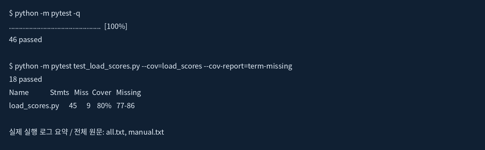

# 성적 CSV 검증 프로그램

## ① 무엇을 하나요
성적 CSV에서 이름과 0~100점 정수를 읽고, 유효한 행과 제외한 행의 기록을 나누어 반환합니다. 동명이인은 모두 남깁니다.

## ② 왜 만들었나요
실습용 CSV에는 빈 점수, 정수가 아닌 점수, 범위를 벗어난 점수와 잘못된 열 개수가 섞여 있습니다. 이런 행 하나 때문에 전체 읽기가 중단되지 않게 하고, 제외한 이유도 확인하기 위해 만들었습니다. 이 설명은 배포 자료의 문제 상황을 바탕으로 AI가 작성한 초안이며 제출 전에 본인의 동기와 맞는지 확인해야 합니다.

## ③ 어떻게 쓰나요
Python 3.10 이상에서 터미널의 현재 위치를 이 README가 있는 week11 폴더로 옮깁니다.
```bash
python -m pip install -r requirements.txt
python load_scores.py scores.csv
```
Windows에서 python이 없으면 py로 바꾸고, macOS에서 필요하면 python3로 바꿉니다.
정상 결과는 유효한 행 5개, 제외한 행 5개입니다. 빈 줄은 제외 기록에 넣지 않습니다.

## ④ 어떻게 테스트하나요
```bash
python -m pytest -q
python -m pytest test_load_scores.py --cov=load_scores --cov-report=term-missing
```
검증 환경 Python 3.12.14 / pytest 9.2.0. 기본 실행 46 passed. 세 묶음 각각 18 / 13 / 15개입니다.
load_scores.py 전체 커버리지는 각각 80%이며 누락 줄은 77, 79~86입니다. 명령행 진입·출력 부분은 함수 단위 테스트에서 실행하지 않습니다.
실제 실행 출력은 results 폴더에 있습니다.



실패 관찰 실험은 기본 수집에서 제외한 파일에 따로 두었습니다. 아래 명령은 각각 1개, 2개가 실패해야 실험 결과와 같습니다.
```bash
python -m pytest experiments/intentional_failure.py -q
python -m pytest experiments/bug_probe.py -q
```
함정 파일의 원본 버그는 고치지 않았습니다. 마지막 원소가 최댓값인 경우와 합격 기준점 자체를 확인합니다.

## ⑤ 파일 구성
| 파일 | 역할 |
| --- | --- |
| load_scores.py | 배포받은 CSV 처리 함수, 원본 유지 |
| scores.csv / empty.csv / weird.csv | 배포 데이터 |
| test_load_scores.py | 설계표 기반 테스트와 추가 검증 |
| test_ai_A.py / test_ai_B.py | 동일 대화에서 만든 AI 비교용 초안 |
| experiments/bug_probe.py | 함정 코드 버그 검출 실험 |
| experiments/intentional_failure.py | 의도적 실패 관찰 |
| results/ | 실행 로그, 커버리지, 통과 출력 이미지 |
| prompts.txt | 배포 프롬프트 원문 |
| requirements.txt | 테스트 의존성 |
| LICENSE | MIT 라이선스 |

## ⑥ 만든 사람 · AI 사용
- 제출자: 이규은 / 2026100320
- AI 사용: 테스트 작성, 실행 확인, README, 워크시트 초안 작성.
- 직접 판단한 사항: 아직 확인 전. 설계표, 제작 동기와 소감을 본인이 검토해야 합니다.
- A/B 및 함정 코드는 동일 대화에서 생성했습니다. 별도 새 대화 3회, 코드 비공개 B 조건을 지킨 실험으로 간주할 수 없습니다. 독립 실험 후 원문 응답 파일로 교체하고 결과를 갱신하세요.
- 실제 짝 검증과 GitHub 업로드는 아직 진행하지 않았습니다.

## 라이선스
MIT License. 배포된 수업 자료가 포함되어 있으므로 원저작자의 이용 조건도 확인해야 합니다.
